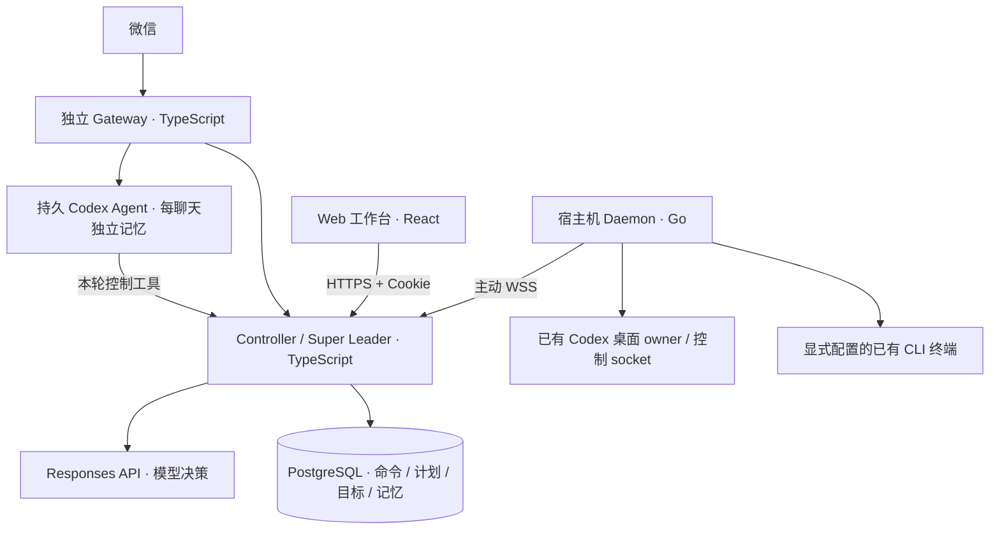

# wechat-super-leader-bot

> 微信 Super Leader：用自然语言查询、控制多台机器上已有的 Agent 会话，
> 在明确授权后安排任务、传递结果，并通过 Web 工作台核对进度与回执。

## 架构总览



Controller 是唯一编排权威：模型提出决策，Controller 校验授权、冻结输入、持久化和派发。
Gateway 独立维护微信登录与同步状态；Codex 回复模式为每个账户和聊天维护独立 Codex 会话与文件记忆。
查询或控制外部项目时，Agent 通过本轮绑定原始用户消息的工具调用 Controller，由 Controller 校验和派发。
Daemon 原生运行在 Mac/Linux 宿主机，连接已有会话；用户仍可在原客户端操作这些会话。

香港 Docker 运行 Controller、Web、PostgreSQL 和独立 Gateway；宿主机主动连接 WSS，
不需要给 Mac 开公网入站端口。桌面控制优先使用已有 owner；未加载会话可通过配置的
app-server 按原 ID 恢复后发送，不创建替代会话。已有 writer 冲突时明确失败，不抢占、不自动换路。

## 入口与代码布局

| 入口 | 用途 |
| --- | --- |
| [leader.taoai.site](https://leader.taoai.site) | 线上控制台，通过微信一次性链接登录 |
| `http://127.0.0.1:8790` | 独立本机 Controller / Web |
| `/health` | Controller 存活检查 |
| `/v1/daemon` | 认证 Daemon WebSocket |
| `scripts/local.mjs` | 本机初始化、启停、状态查询 |
| `scripts/verify.mjs` | 合成目标的统一验证入口 |

```text
controller/src/ commands/、http/、leader/、nodes/、notifications/、sessions/、skills/、store/
daemon/cmd/     super-leader-daemon CLI 入口
daemon/pkg/     client/、codex/{appserver,desktop,rollout}/、protocol/、service/
gateway/src/    cli/、controller/、leader/、runtime/、wechat/
web/src/        api/、auth/、features/{leader,sessions,status}/
scripts/        local.mjs、verify.mjs、lib/、ops/
tests/          跨组件集成测试、CLI 与部署测试
deploy/         Dockerfile、生产 Compose、Nginx 与节点配置工具
compose.yaml    本机控制平面基础编排
```

项目说明集中在本 README；运行合同与验证以对应源码和测试为准。

## 使用方式

在微信中可以说：“看看这台机器有哪些会话”“这个会话进展怎么样”“给我控制台链接”。
具体会话的历史查询只读取已记录内容，并标明来源、获取时间和裁剪，不把元数据冒充输出。

| 能力 | 授权与执行方式 |
| --- | --- |
| 单步任务 | 明确下达任务后核对目标、内容和技能，直接发送到原会话，不要求再回复确认 |
| 固定计划 | 最多 4 步，冻结依赖与目标；精确完成回执才解锁后继 |
| 结果传递 | 按任务指定的共享来源，后继使用前驱精确完成的已记录结果 |
| 持续目标 | 明确要求持续推进，且目标、条件、范围和预算清楚时直接开始，根据结果决定下一步 |
| 有序技能 | 每任务最多 4 个技能，授权入库和派发均核对顺序与版本摘要 |
| 任务排队 | 已知会话忙碌或机器离线时保存待发送内容；原会话恢复可用后按顺序投递，未发送前可取消 |
| 进度与结果 | Gateway 显式开启后，长任务最多同步 3 次真实进展；完成结果保留原始 Markdown 并分段发送 |
| 会话图片 | 明确要求发送后，读取原会话中的图片附件并发到当前微信聊天，一次最多 3 张 |

例如：“让代码审查会话检查这个提交，只读，完成后告诉我结果”会直接派发；目标不明确才追问。
说“先给我方案，别执行”才只生成预览；预览后 10 分钟内回复“执行”即可，中途查询不会清除预览。
固定计划授权最多延续 24 小时；取消只停止后继，不终止已运行任务。
日常回复使用简短列表；完成通知保留原任务最终回答，不摘要、不截断，也不把处理中消息当结果。
收到已授权消息、发送进度及最终结果前尝试显示输入中；微信接口异常不会因此阻止正文处理。
明确要求补充当前轮时，只有能核对准确运行轮次且控制通道支持追加才执行，不降级为另开一轮。
持续目标同时约束次数和时间；失败、结果不明、证据不足或预算耗尽时停止并保留记录。
每个聊天同时只允许一个未结束的持续目标或固定计划。

图片来源包括原生附件和原会话实际渲染的 Markdown 本地图片，不接受模型给出的任意文件路径或下载地址。
图片逐一核对会话、文件身份与摘要，仅支持 PNG/JPEG/GIF/WebP，单图最多 8 MiB。
这依赖原会话附件本身可信，不额外隔离原 Agent 的文件权限；冻结的待发图片保留 24 小时，过期后需重新请求。

Web 提供机器与会话搜索、原来源历史、直接发送、排队取消、计划和目标进度。
看板仅同步有界预览；展开某条回执时才读取该条完整结果，收起后释放正文，避免大结果拖慢刷新。
手机底栏切换会话与看板，聊天顶栏保留模型、状态和详情入口；返回列表保留草稿与阅读位置。
向上滚动自动加载更早历史，新消息不会打断阅读；看板优先展示待处理和执行中记录，完成记录可展开。
状态通过认证 SSE 更新，断流后轮询兜底；历史首屏读取最近一页，切回会话先显示有界内存缓存并后台更新，不是 token 流式输出。
读取旧消息时保留滚动位置；来源失效后暂停，用户可显式重新读取最新页。

## 控制台登录

1. 在已授权微信聊天中发送“给我控制台链接”。
2. 打开形如 `https://leader.taoai.site/#login=<一次性凭证>` 的链接。
3. 页面立即清除地址栏 fragment/query，兑换 `HttpOnly` Cookie；登录态固定有效 1 小时。

链接有效 1 小时、仅可兑换一次，持有即可登录，请勿转发。
浏览器不保存管理 Bearer token；Cookie 仅授予状态/历史查询与准确会话发送权限。
发送要求同源 Origin、专用 intent header 和有效会话资格，通用管理写接口不接受 Cookie。

## 本机开发

需要 Node.js >=24、pnpm 11.8.0、`daemon/go.mod` 指定的 Go，以及本地 Docker / Compose。
先安装三个组件的锁定依赖，并构建前台 Daemon：

```sh
pnpm --dir controller install --frozen-lockfile
pnpm --dir gateway install --frozen-lockfile
pnpm --dir web install --frozen-lockfile
pnpm --dir gateway build
(cd daemon && go build -o bin/super-leader-daemon ./cmd/super-leader-daemon)
node scripts/local.mjs --init
```

`--init` 只创建不存在的私有配置，默认微信允许名单为空。
`.runtime/local.json`、`.runtime/daemon-state/` 和微信状态是持久运行数据，不提交、不删除。

自然语言模式使用 Responses API。启动前通过私有进程环境配置：

| 变量 | 用途 |
| --- | --- |
| `LEADER_MODE=model` | 启用模型决策；默认 `rules` 仅用于诊断 |
| `LEADER_MODEL_BASE_URL` | 当前 provider 的 API 基址，包含 `/v1` |
| `LEADER_MODEL_NAME` | 实际可用模型名 |
| `LEADER_MODEL_API_KEY` | provider 密钥，不放入仓库或 shell 历史 |
| `CONSOLE_PUBLIC_URL=http://127.0.0.1:8790` | 本机签发控制台链接所需的公开 origin |
| `CONTROLLER_HTTPS_PROXY` | 可选的实际出网代理地址 |

```sh
node scripts/local.mjs --up
node scripts/local.mjs --daemon
# 另开终端
node scripts/local.mjs --check
node scripts/local.mjs --sessions
```

`--up` 构建本机 Controller / Web / PostgreSQL；启动器默认使用独立 `docker-compose`。
`--daemon` 为前台开发运行；已有用户服务在运行时，通过该服务管理节点。
`--down` 停止本机容器并保留数据库卷。已连接香港的节点使用远端查询入口，
不要再启动第二个编排权威；`--gateway` 会真实轮询微信，必须先配置并核实允许名单。

## 原生 Daemon

macOS 使用当前登录用户的 LaunchAgent，Linux 使用当前用户的 `systemd --user`。
稳定二进制位于 `~/.local/share/super-leader/bin/super-leader-daemon`：

```sh
~/.local/share/super-leader/bin/super-leader-daemon --service status
node scripts/local.mjs --check --controller https://leader.taoai.site
node scripts/local.mjs --sessions --controller https://leader.taoai.site
```

同一入口支持 `--service install|start|stop|restart|uninstall`。
安装/更新使用本机架构的新二进制，显式提供本机 node-id、WSS 地址、私有 token-file、
原 state-dir、实际 socket 与完整技能根目录；不要复制另一台机器的路径或凭证。
`uninstall` 删除服务定义，保留二进制、token、日志和 journal。

| 参数 | 作用与边界 |
| --- | --- |
| `--sock` | 已有 Codex 控制 socket；可按原 ID 恢复未加载会话，不创建后端 |
| `--desktop-sock` | 已有桌面 IPC 的状态、模型与历史观测 |
| `--desktop-send` | 显式开启原桌面 owner 发送，要求 desktop socket |
| `--codex-home` | 只读文件元数据发现，不等于历史或发送授权 |
| `--terminal-sock` / `--terminal-pane` | 显式指定已有终端和准确 pane |
| `--terminal-history-root` | 逐提供方授权已记录 CLI 历史目录 |
| `--terminal-send-mode=non-atomic` | 显式接受已有 PTY 单步输入的非原子边界 |
| `--probe` | 只读诊断，不连接 Controller 或写 journal |

桌面观测与发送资格独立；失联、过期或 owner 不符时降级为只读，不自动换路。
桌面内部协议会随客户端版本变化，升级后需要重新核对。
Linux 用户服务不自动启用 linger；服务在线不代表原会话可控。

## 部署与微信运行

基础编排为 `compose.yaml`，生产限制为 `deploy/compose.production.yaml`，
微信独立服务为 `deploy/compose.gateway.yaml`，仅显式选择 `wechat` profile 才启动。
镜像入口为 `deploy/Dockerfile.controller` 和 `deploy/Dockerfile.gateway`。

私有生产配置位于 `.runtime/controller.env`。只读检查使用以下命令，避免输出展开后的密钥：

```sh
docker compose --env-file .runtime/controller.env \
  -f compose.yaml -f deploy/compose.production.yaml -f deploy/compose.gateway.yaml \
  --profile wechat config --quiet
docker compose --env-file .runtime/controller.env \
  -f compose.yaml -f deploy/compose.production.yaml -f deploy/compose.gateway.yaml \
  --profile wechat ps
```

生产镜像先在开发机或 CI 按目标架构构建并验证，再加载和切换。
更新前全量核查在途命令、claim、计划和目标，并排空唯一 Gateway、冻结写入口；
状态页只展示近期记录，不能作为排空依据。沿用原数据库、节点 journal 与微信 checkpoint。

生产 Gateway 默认启用 `GATEWAY_LEADER_MODE=codex`，模型默认为 `gpt-6.1-sol`。
凭证只通过私有环境提供：`GATEWAY_LEADER_API_KEY`、可选的 `GATEWAY_LEADER_BASE_URL`；
Compose 未单独配置时沿用 `LEADER_MODEL_API_KEY`、`LEADER_MODEL_BASE_URL`。
`GATEWAY_LEADER_MODE=controller` 可显式选择原 Controller 回复入口。
Codex SDK 与原生 CLI 固定在 `0.163.0`；镜像安装时显式选择目标架构的 CLI 包，不能直接复制开发机原生 CLI。
香港生产主机为 `linux/amd64`，开发机为 ARM 时构建需显式指定 `--platform linux/amd64`。

Codex 记忆根目录为 `GATEWAY_LEADER_ROOT=/var/lib/super-leader-gateway/leader`，
位于已有 `WECHAT_STATE_DIR` 持久挂载中。账户和聊天按摘要分目录，每个目录保存
`task.md`（目标、进度和证据）、`memory.md`（长期事实）、`preference.md`（用户明确偏好），
以及独立 `.codex` 会话数据、会话 ID 和回复防重日志。每轮注入磁盘中的记忆快照，
Agent 可通过原生文件工具读取完整内容，并在回复前维护相关文件；续聊恢复原 Codex 会话。
现存 `profile.md` 在首次打开工作目录时迁移到 `preference.md`，保留原内容；有冲突时合并。
记忆提供上下文，不能新增执行授权，执行状态仍须查询 Controller 回执。
未来工具与技能继续使用 Codex 原生发现机制，不另维护静态工具清单。

延期回复按来源读取冻结结果，不重新调用模型或执行控制；发送完成凭证先持久保存，再确认和清理回复记录。
每个聊天保留最多 128 条待交付或结果不明的记录，另保留最近 64 条已关闭记录，总日志上限 16 MiB。
待交付记录不会被滚动淘汰；容量不足时先尝试发送旧回复，仍不足则保留入站游标，等待恢复。
同一个记忆根目录必须由单个 Gateway 进程独占，不支持多进程共享；升级必须先确认旧进程完全退出。

容器以非 root 用户运行，根文件系统只读；仅持久状态目录和 `/tmp` 可写。
Codex 的文件权限依赖内层 Linux sandbox，宿主需允许非特权 user namespace。
生产 Compose 使用 `deploy/security/codex-seccomp.json` 和独立 AppArmor profile
`super-leader-codex`，保留 Docker 默认规则，仅开放 pinned CLI 创建内层 sandbox 所需调用。
上线前在宿主安装并加载专属策略：

```sh
install -m0644 deploy/security/codex-apparmor /etc/apparmor.d/super-leader-codex
apparmor_parser -Kr /etc/apparmor.d/super-leader-codex
systemctl is-enabled apparmor.service
systemctl is-active apparmor.service
```

持久安装保证宿主重启后 AppArmor 服务能重新加载该 profile，随后 Docker 才能启动 Gateway。
不支持 AppArmor 或 user namespace 的主机应先完成等效隔离验证，不能直接关闭 sandbox 或放开容器权限。
CLI、Docker、内核版本或网络模式变化后需重新验证这些策略；在目标原生架构的合成容器中
确认三份记忆可写、其他聊天和微信凭据不可读，再切换正式 Gateway。
首次启用需确认已有状态目录对 UID/GID `1000:1000` 可写。升级保留整个状态目录，
不要只复制微信 `state.json` 或删除 `.codex` 数据。停止 Gateway 使用 Compose 的
1200 秒宽限期，让正在处理的消息退出；确认容器已停止后再切换，避免两个轮询器并行。

同一微信账号只能有一个 Gateway 轮询。`ALLOWED_CHAT_IDS` 授权操作者，登录凭证不能代替授权。
新账号首次运行前执行 `--establish-baseline`，读取到原始空页，只记录上下文、去重和游标，
不回复历史消息；正常重启沿用已有基线，不重新建立。通知默认关闭，
通过 `GATEWAY_NOTIFICATIONS=true` 或 `--notifications` 显式开启，未知投递结果不重发。

微信发送采用可调整的本地保守策略，不把经验值当作官方协议上限：

| Gateway 配置 | 默认值 | 含义 |
| --- | --- | --- |
| `GATEWAY_MAX_CHARS` | `3800` | 每段 UTF-16 长度，保留原始 Markdown 和完整 Unicode 字符 |
| `GATEWAY_CONTEXT_WINDOW_MS` | `82800000` | 新消息建立的回复窗口，默认 23 小时 |
| `GATEWAY_SEND_BUDGET` | `10` | 每次有效新入站可用的发送次数；文字分段、图片分别计数，输入中不计数 |
| `GATEWAY_OUTBOX_LIMIT` | `1000` | 本地持久待发引用容量，正文仍由 Controller 保存 |
| `GATEWAY_POLL_TIMEOUT_MS` | `35000` | 初始长轮询时限；跟随有效服务端建议，HTTP 另留 5 秒余量 |

窗口与额度只由带有效时间和上下文的新消息刷新，重复、乱序和建立基线不会补额度。
额度用完或窗口过期时暂停发送，仍继续收取新消息；用户再次发消息后，从尚未发送的分段继续，
不重新执行原任务。重启沿用待发引用和已确认分段，历史状态缺少可信窗口时间时需用户先发一条新消息。
进度最多使用 3 次发送，并为最终回复预留额度；完成通知仍有独立的 24 小时保留期，延期不延长该期限。
窗口、额度和待发容量可分别调整到应用资源上限 7 天、1000 次、1000 条；调大不保证微信接受。
零字节 HTTP 回执不等于 JSON `{}`：前者保留为结果未知，禁止盲目重发；接口受理不代表手机已读。

## 验证与结果边界

```sh
node scripts/verify.mjs                     # 完整验证
node scripts/verify.mjs --suite unit        # 单测、构建、Go race/vet，无需 Docker
node scripts/verify.mjs --suite integration # 构建、临时 PostgreSQL 与集成验证
node scripts/verify.mjs --list              # 查看计划，不运行检查
```

完整验证使用本地 Unix Docker socket 和 `postgres:16-alpine`，拒绝远端 Docker engine。
验证清除真实业务配置与 LIVE 开关，使用合成模型、微信和桌面目标；
不部署或触达正式会话。CI 在 Ubuntu 运行全量、macOS 运行 unit，使用 Node 24。

| 回执 | 能证明什么 |
| --- | --- |
| `queued` | 尚未投递，等待原会话可用；允许取消，超过有效期不会发送 |
| `accepted` | 已受理，需要继续核对原请求与准确 turn |
| 精确完成回执 | 对应原任务已结束，并有该 turn 的已记录结果 |
| CLI `input-written` | 输入已写入，执行与完成未确认，不能解锁后继或参与目标闭环 |
| `uncertain` | 结果未知，核查原请求，不改 requestId 重发 |
| 微信发送 `accepted` | 微信接口受理，不证明手机收到或已读 |

投递超时不会换请求 ID 盲目重发；先核对原命令的持久回执。微信结果不明的分段保留防重记录并隔离原消息，不阻塞后续聊天。
单任务结果最多 8 MiB UTF-8，超过边界明确报错，不返回伪装完整的节选；通知按有界分片保存和投递。
涉及新通知格式、分段 checkpoint 或大结果 journal 的升级，产生新数据后优先向前修复，不能直接换回旧版二进制。

持续目标的“完成”是模型依据记录判断条件满足，不等于独立业务验收。
已有 Air 单节点原会话联调与微信登录链接核验；真实手机会话控制、跨物理机闭环、
Mini 实际发送、真实 CLI 与 Linux 服务仍需各自验收。
