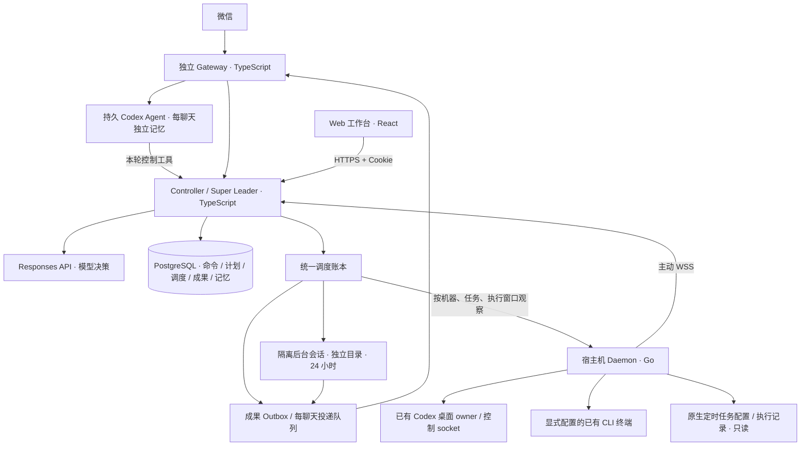

# wechat-super-leader-bot

> 微信 Super Leader：用自然语言查询、控制多台机器上已有的 Agent 会话，
> 在明确授权后安排任务、传递结果，并通过 Web 工作台核对进度与回执。

## 架构总览



Controller 是唯一编排权威：模型提出决策，Controller 校验授权、冻结输入、持久化和派发。
Gateway 独立维护微信登录与同步状态；Codex 回复模式为每个账户和聊天维护独立 Codex 会话与文件记忆。
查询或控制外部项目时，Agent 通过本轮绑定原始用户消息的工具调用 Controller，由 Controller 校验和派发。
Daemon 原生运行在 Mac/Linux 宿主机，连接已有会话；用户仍可在原客户端操作这些会话。

香港 Docker 运行 Controller、Web、PostgreSQL 和独立 Gateway；宿主机主动连接 WSS，
不需要给 Mac 开公网入站端口。桌面控制优先使用已有 owner；未加载会话可通过配置的
app-server 按原 ID 恢复后发送，不创建替代会话。已有 writer 冲突时明确失败，不抢占、不自动换路。

## 入口与代码布局

| 入口 | 用途 |
| --- | --- |
| [leader.taoai.site](https://leader.taoai.site) | 线上控制台，通过微信一次性链接登录 |
| `http://127.0.0.1:8790` | 独立本机 Controller / Web |
| `/health` | Controller 存活检查 |
| `/v1/daemon` | 认证 Daemon WebSocket |
| `scripts/local.mjs` | 本机初始化、启停、状态查询 |
| `scripts/verify.mjs` | 合成目标的统一验证入口 |

```text
controller/src/ automations/、background/、commands/、http/、leader/、nodes/、notifications/、sessions/、skills/、store/
daemon/cmd/     super-leader-daemon CLI 入口
daemon/pkg/     client/、codex/{appserver,desktop,rollout}/、protocol/、service/
gateway/src/    cli/、controller/、leader/、runtime/、wechat/
web/src/        api/、auth/、features/{leader,sessions,status}/
scripts/        local.mjs、verify.mjs、lib/、ops/
tests/          跨组件集成测试、CLI 与部署测试
deploy/         Dockerfile、生产 Compose、Nginx 与节点配置工具
compose.yaml    本机控制平面基础编排
```

项目说明集中在本 README；运行合同与验证以对应源码和测试为准。

## 使用方式

在微信中可以说：“看看这台机器有哪些会话”“这个会话进展怎么样”“给我控制台链接”。
具体会话的历史查询只读取已记录内容，并标明来源、获取时间和裁剪，不把元数据冒充输出。

| 能力 | 授权与执行方式 |
| --- | --- |
| 单步任务 | 明确下达任务后核对目标、内容和技能，直接发送到原会话，不要求再回复确认 |
| 固定计划 | 最多 4 步，冻结依赖与目标；精确完成回执才解锁后继 |
| 结果传递 | 按任务指定的共享来源，后继使用前驱精确完成的已记录结果 |
| 持续目标 | 明确要求持续推进，且目标、条件、范围和预算清楚时直接开始，根据结果决定下一步 |
| 有序技能 | 每任务最多 4 个技能，授权入库和派发均核对顺序与版本摘要 |
| 任务排队 | 已知会话忙碌或机器离线时保存待发送内容；原会话恢复可用后按顺序投递，未发送前可取消 |
| 进度与结果 | Gateway 显式开启后，长任务最多同步 3 次真实进展；结果不超过 3 条时完整分条发送，更长则发送模型摘要和完整附件 |
| 定时任务 | 自然语言创建单次提醒、cron 会话任务或隔离后台任务，可查询、暂停、恢复和取消；执行记录与通知投递分别保存 |
| 跨机定时观察 | 只读收集不同机器上的 Codex 原生定时任务结果，延迟时继续检查，按截止时间汇总 |
| 隔离后台执行 | 独立会话和可写目录完成小任务，默认保留 24 小时，支持原上下文追问与显式延期 |
| 会话图片 | 明确要求发送后，读取原会话中的图片附件并发到当前微信聊天，一次最多 3 张 |

例如：“让代码审查会话检查这个提交，只读，完成后告诉我结果”会直接派发；目标不明确才追问。
说“先给我方案，别执行”才只生成预览；预览后 10 分钟内回复“执行”即可，中途查询不会清除预览。
固定计划授权最多延续 24 小时；取消只停止后继，不终止已运行任务。
日常回复使用简短列表；委派确认由模型依据原请求及准确轮次的执行记录生成，排队和受理分别如实说明。
完成成果保留原任务完整 Markdown，不把处理中消息当结果。
收到已授权消息、发送进度及最终结果前尝试显示输入中；微信接口异常不会因此阻止正文处理。
明确要求补充当前轮时，只有能核对准确运行轮次且控制通道支持追加才执行，不降级为另开一轮。
持续目标同时约束次数和时间；失败、结果不明、证据不足或预算耗尽时停止并保留记录。
每个聊天同时只允许一个未结束的持续目标或固定计划。

图片来源包括原生附件和原会话实际渲染的 Markdown 本地图片，不接受模型给出的任意文件路径或下载地址。
图片逐一核对会话、文件身份与摘要，仅支持 PNG/JPEG/GIF/WebP，单图最多 8 MiB。
这依赖原会话附件本身可信，不额外隔离原 Agent 的文件权限；冻结的待发图片保留 24 小时，过期后需重新请求。

Web 提供机器与会话搜索、原来源历史、直接发送、排队取消、计划和目标进度。
看板还显示定时任务、执行回执与成果投递状态；可以按需读取完整成果，并暂停、恢复或取消定时任务。
看板仅同步有界预览；展开某条回执时才读取该条完整结果，收起后释放正文，避免大结果拖慢刷新。
手机底栏切换会话与看板，聊天顶栏保留模型、状态和详情入口；返回列表保留草稿与阅读位置。
工具以单行摘要展示：手机点开底部详情面板，可拖动或点击扩大、收起；桌面原位展开。消息支持复制，时间统一为 UTC+8。
向上滚动自动加载更早历史，新消息不会打断阅读；看板优先展示待处理和执行中记录，完成记录可展开。
状态通过认证 SSE 更新，断流后轮询兜底；历史首屏读取最近一页，切回会话先显示有界内存缓存并后台更新，不是 token 流式输出。
读取旧消息时保留滚动位置；来源失效后暂停，用户可显式重新读取最新页。

## 控制台登录

1. 在已授权微信聊天中发送“给我控制台链接”。
2. 打开形如 `https://leader.taoai.site/#login=<一次性凭证>` 的链接。
3. 页面立即清除地址栏 fragment/query，兑换 `HttpOnly` Cookie；登录态固定有效 1 小时。

链接有效 1 小时、仅可兑换一次，持有即可登录，请勿转发。
浏览器不保存管理 Bearer token；Cookie 仅授予状态/历史查询与准确会话发送权限。
发送要求同源 Origin、专用 intent header 和有效会话资格，通用管理写接口不接受 Cookie。

## 本机开发

需要 Node.js >=24、pnpm 11.8.0、`daemon/go.mod` 指定的 Go，以及本地 Docker / Compose。
先安装三个组件的锁定依赖，并构建前台 Daemon：

```sh
pnpm --dir controller install --frozen-lockfile
pnpm --dir gateway install --frozen-lockfile
pnpm --dir web install --frozen-lockfile
pnpm --dir gateway build
(cd daemon && go build -o bin/super-leader-daemon ./cmd/super-leader-daemon)
node scripts/local.mjs --init
```

`--init` 只创建不存在的私有配置，默认微信允许名单为空。
`.runtime/local.json`、`.runtime/daemon-state/` 和微信状态是持久运行数据，不提交、不删除。

自然语言模式使用 Responses API。启动前通过私有进程环境配置：

| 变量 | 用途 |
| --- | --- |
| `LEADER_MODE=model` | 启用模型决策；默认 `rules` 仅用于诊断 |
| `LEADER_MODEL_BASE_URL` | 当前 provider 的 API 基址，包含 `/v1` |
| `LEADER_MODEL_NAME` | 实际可用模型名 |
| `LEADER_MODEL_API_KEY` | provider 密钥，不放入仓库或 shell 历史 |
| `CONSOLE_PUBLIC_URL=http://127.0.0.1:8790` | 本机签发控制台链接所需的公开 origin |
| `CONTROLLER_HTTPS_PROXY` | 可选的实际出网代理地址 |

```sh
node scripts/local.mjs --up
node scripts/local.mjs --daemon
# 另开终端
node scripts/local.mjs --check
node scripts/local.mjs --sessions
```

`--up` 构建本机 Controller / Web / PostgreSQL；启动器默认使用独立 `docker-compose`。
`--daemon` 为前台开发运行；已有用户服务在运行时，通过该服务管理节点。
`--down` 停止本机容器并保留数据库卷。已连接香港的节点使用远端查询入口，
不要再启动第二个编排权威；`--gateway` 会真实轮询微信，必须先配置并核实允许名单。

## 原生 Daemon

macOS 使用当前登录用户的 LaunchAgent，Linux 使用当前用户的 `systemd --user`。
稳定二进制位于 `~/.local/share/super-leader/bin/super-leader-daemon`：

```sh
~/.local/share/super-leader/bin/super-leader-daemon --service status
node scripts/local.mjs --check --controller https://leader.taoai.site
node scripts/local.mjs --sessions --controller https://leader.taoai.site
```

同一入口支持 `--service install|start|stop|restart|uninstall`。
安装/更新使用本机架构的新二进制，显式提供本机 node-id、WSS 地址、私有 token-file、
原 state-dir、实际 socket 与完整技能根目录；不要复制另一台机器的路径或凭证。
`uninstall` 删除服务定义，保留二进制、token、日志和 journal。

| 参数 | 作用与边界 |
| --- | --- |
| `--sock` | 已有 Codex 控制 socket；可按原 ID 恢复未加载会话，不创建后端 |
| `--desktop-sock` | 已有桌面 IPC 的状态、模型与历史观测 |
| `--desktop-send` | 显式开启原桌面 owner 发送，要求 desktop socket |
| `--codex-home` | 只读发现会话元数据与原生定时任务配置、执行记录；不授予发送权限 |
| `--terminal-sock` / `--terminal-pane` | 显式指定已有终端和准确 pane |
| `--terminal-history-root` | 逐提供方授权已记录 CLI 历史目录 |
| `--terminal-send-mode=non-atomic` | 显式接受已有 PTY 单步输入的非原子边界 |
| `--probe` | 只读诊断，不连接 Controller 或写 journal |

桌面观测与发送资格独立；失联、过期或 owner 不符时降级为只读，不自动换路。
桌面内部协议会随客户端版本变化，升级后需要重新核对。
Linux 用户服务不自动启用 linger；服务在线不代表原会话可控。

## 部署与微信运行

基础编排为 `compose.yaml`，生产限制为 `deploy/compose.production.yaml`，
微信独立服务为 `deploy/compose.gateway.yaml`，仅显式选择 `wechat` profile 才启动。
镜像入口为 `deploy/Dockerfile.controller` 和 `deploy/Dockerfile.gateway`。

私有生产配置位于 `.runtime/controller.env`。只读检查使用以下命令，避免输出展开后的密钥：

```sh
docker compose --env-file .runtime/controller.env \
  -f compose.yaml -f deploy/compose.production.yaml -f deploy/compose.gateway.yaml \
  --profile wechat config --quiet
docker compose --env-file .runtime/controller.env \
  -f compose.yaml -f deploy/compose.production.yaml -f deploy/compose.gateway.yaml \
  --profile wechat ps
```

生产镜像先在开发机或 CI 按目标架构构建并验证，再加载和切换。
更新前全量核查在途命令、claim、计划和目标，并排空唯一 Gateway、冻结写入口；
状态页只展示近期记录，不能作为排空依据。沿用原数据库、节点 journal 与微信 checkpoint。

生产 Gateway 默认启用 `GATEWAY_LEADER_MODE=codex`，模型默认为 `gpt-6.1-sol`。
凭证只通过私有环境提供：`GATEWAY_LEADER_API_KEY`、可选的 `GATEWAY_LEADER_BASE_URL`；
Compose 未单独配置时沿用 `LEADER_MODEL_API_KEY`、`LEADER_MODEL_BASE_URL`。
`GATEWAY_LEADER_MODE=controller` 可显式选择原 Controller 回复入口。
Codex SDK 与原生 CLI 固定在 `0.163.0`；镜像安装时显式选择目标架构的 CLI 包，不能直接复制开发机原生 CLI。
香港生产主机为 `linux/amd64`，开发机为 ARM 时构建需显式指定 `--platform linux/amd64`。

Codex 记忆根目录为 `GATEWAY_LEADER_ROOT=/var/lib/super-leader-gateway/leader`，
位于已有 `WECHAT_STATE_DIR` 持久挂载中。账户和聊天按摘要分目录，每个目录保存
`task.md`（目标、进度和证据）、`memory.md`（长期事实）、`preference.md`（用户明确偏好），
以及独立 `.codex` 会话数据、会话 ID 和回复防重日志。每轮注入磁盘中的记忆快照，
Agent 可通过原生文件工具读取完整内容，并在回复前维护相关文件；续聊恢复原 Codex 会话。
现存 `profile.md` 在首次打开工作目录时迁移到 `preference.md`，保留原内容；有冲突时合并。
记忆提供上下文，不能新增执行授权，执行状态仍须查询 Controller 回执。
未来工具与技能继续使用 Codex 原生发现机制，不另维护静态工具清单。

无头 Codex 显式启用实时网络搜索、Shell、可续接命令、Shell 快照、技能发现、本地图片查看和等待工具，
并配置无需登录的可选 OpenAI Docs HTTP MCP；其实际可用性取决于服务器网络出口，服务不可用时仍可启动模型并使用实时搜索。
微信主会话同时启用多 Agent、V2 协作和 Goals，最多两个并发子线程，整轮仍受原有 300 秒预算约束；
Goals 用于本轮目标管理，`exec` 完成后的自动续轮未作保证。后台 worker 使用相同的搜索与文档能力，继续由 Controller 管理并发、续跑和过期，
不另启子 Agent 或 Goals。浏览器、Computer use 与桌面自动化在两条路径均显式关闭。
这些配置不依赖开发机的配置文件、桌面插件、通知程序或本机路径。
技能发现保留；由于 Codex 私有目录整体隔离，关闭该目录中不可读取的内置技能目录展示。
两运行镜像包含 Python 3、curl、BeautifulSoup 和 html2text，随镜像只读提供
`/etc/codex/skills/web-content-fetcher`，由 Codex 原生管理员技能目录发现。
主聊天和后台 worker 只增加该技能目录的读取权限，不开放本机配置或私有 Codex 目录。
该技能用于 HTTP/HTTPS 网页正文读取；需要登录、浏览器渲染或遇到验证页时如实说明，
不将验证页视为文章，不启动浏览器。完整命令及边界见技能目录内的 `SKILL.md`。
聊天工作目录 `.agents/skills` 的原生发现仍保留。

延期回复按来源读取冻结结果，不重新调用模型或执行控制；发送完成凭证先持久保存，再确认和清理回复记录。
每个聊天保留最多 128 条待交付或结果不明的记录，另保留最近 64 条已关闭记录，总日志上限 16 MiB。
待交付记录不会被滚动淘汰；容量不足时先尝试发送旧回复，仍不足则保留入站游标，等待恢复。
同一个记忆根目录必须由单个 Gateway 进程独占，不支持多进程共享；升级必须先确认旧进程完全退出。

容器以非 root 用户运行，根文件系统只读；仅持久状态目录和 `/tmp` 可写。
Codex 的文件权限依赖内层 Linux sandbox，宿主需允许非特权 user namespace。
生产 Compose 使用 `deploy/security/codex-seccomp.json` 和独立 AppArmor profile
`super-leader-codex`，保留 Docker 默认规则，仅开放 pinned CLI 创建内层 sandbox 所需调用。
上线前在宿主安装并加载专属策略：

```sh
install -m0644 deploy/security/codex-apparmor /etc/apparmor.d/super-leader-codex
apparmor_parser -Kr /etc/apparmor.d/super-leader-codex
systemctl is-enabled apparmor.service
systemctl is-active apparmor.service
```

持久安装保证宿主重启后 AppArmor 服务能重新加载该 profile，随后 Docker 才能启动 Gateway。
不支持 AppArmor 或 user namespace 的主机应先完成等效隔离验证，不能直接关闭 sandbox 或放开容器权限。
CLI、Docker、内核版本或网络模式变化后需重新验证这些策略；在目标原生架构的合成容器中
确认三份记忆可写、其他聊天和微信凭据不可读，再切换正式 Gateway。
首次启用需确认已有状态目录对 UID/GID `1000:1000` 可写。升级保留整个状态目录，
不要只复制微信 `state.json` 或删除 `.codex` 数据。停止 Gateway 使用 Compose 的
1200 秒宽限期，让正在处理的消息退出；确认容器已停止后再切换，避免两个轮询器并行。

同一微信账号只能有一个 Gateway 轮询。`ALLOWED_CHAT_IDS` 授权操作者，登录凭证不能代替授权。
新账号首次运行前执行 `--establish-baseline`，读取到原始空页，只记录上下文、去重和游标，
不回复历史消息；正常重启沿用已有基线，不重新建立。通知默认关闭，
通过 `GATEWAY_NOTIFICATIONS=true` 或 `--notifications` 显式开启，未知投递结果不重发。

微信发送采用可调整的本地保守策略，不把经验值当作官方协议上限：

| Gateway 配置 | 默认值 | 含义 |
| --- | --- | --- |
| `GATEWAY_MAX_CHARS` | `3800` | 每段 UTF-16 长度，分段不拆开 Unicode 字符 |
| `GATEWAY_CONTEXT_WINDOW_MS` | `82800000` | 新消息建立的回复窗口，默认 23 小时 |
| `GATEWAY_SEND_BUDGET` | `10` | 每次有效新入站可用的发送次数；文字分段、图片、文件分别计数，输入中不计数 |
| `GATEWAY_OUTBOX_LIMIT` | `1000` | 本地持久待发引用容量，正文仍由 Controller 保存 |
| `GATEWAY_POLL_TIMEOUT_MS` | `35000` | 初始长轮询时限；跟随有效服务端建议，HTTP 另留 5 秒余量 |

窗口与额度只由带有效时间和上下文的新消息刷新，重复、乱序和建立基线不会补额度。
额度用完或窗口过期时暂停发送，仍继续收取新消息；用户再次发消息后，从尚未发送的分段继续，
不重新执行原任务。重启沿用待发引用和已确认分段，历史状态缺少可信窗口时间时需用户先发一条新消息。
进度最多使用 3 次发送，并为最终回复预留额度；完整成果默认独立保留 7 天，投递还需满足业务有效期。
窗口、额度和待发容量可分别调整到应用资源上限 7 天、1000 次、1000 条；调大不保证微信接受。
零字节 HTTP 回执不等于 JSON `{}`：前者保留为结果未知，禁止盲目重发；接口受理不代表手机已读。
普通回复先将 Markdown 转成微信文本，再完整分段；代码、链接目标保留，升级前已建立的分段沿用原计划。
新成果先在 Controller 排版再冻结分段，附件和 Web 全文保留原始 Markdown；旧冻结分段保持原样。
默认用户展示时间使用北京时间，明确指定的调度时区保持原语义。

## 定时任务与成果通知

可以直接说“明天上午九点提醒我检查部署”“每天九点让这个会话检查服务，有变化再通知我”，
或“列出我的定时任务”“暂停这个任务”“恢复这个任务”“取消这个任务”。
定时任务按明确时区保存；同一任务不重叠运行，重启后核查原请求与回执，不重新派发结果未知的执行。
暂停只阻止后续调度轮次，本轮仍会继续收集结果。取消停止后续调度；对于隔离后台任务，
还会停止当前 worker 的后续执行与追问。已有源会话不受影响。监控无变化时保持安静，失败和恢复会产生通知。

任务执行不依赖微信窗口。文字、图片、文件、进度和定时通知共用每聊天的发送账本。
真实新入站刷新窗口与额度；历史基线、重放和状态查询不刷新。
默认本地策略为 23 小时、每次新入站 10 次发送，预留最后 3 次给回复和成果。
进度按里程碑合并，每任务最多 3 次；完成或失败优先于尚未发送的进度。
窗口接近结束时，仅对仍有任务或待发成果的聊天提醒一次。
窗口过期或额度不足时标记等待用户；用户再次发消息后先处理普通回复，再合并、节流恢复待发成果。
每次最多合并 8 份、32 MiB，超额成果继续保留在 Web，不截断正文，也不为补发重新执行任务。
明确未提交的临时下载或上传失败会退避重试；发送结果未知时保留证据并停止自动重发。

完整结果在 3 × 3800 字符内时，优先按原顺序完整发送；更长结果使用 1 条模型摘要和 1 份完整 Markdown 附件。
默认附件阈值为 50 MiB，超过本地配置时发送临时签名下载链接，链接在实际投递时生成。
附件下载和文件上传按实际大小分配有界传输时间，控制请求保留短超时；重试共用同一次上传期限。
提高本地附件阈值也需要配置足够内存；可配置的 512 MiB 上界不代表微信官方支持，也未在默认 512 MiB 容器中验收。
成果默认保留 7 天，独立于微信回复窗口。业务有效期可更短：过期天气等内容不补发，日报可由最新结果替换。
成果状态区分准备中、待投递、等待用户、接口受理、结果未知及已被更新替代；接口受理不代表手机已读。

| 变量 | 默认值与用途 |
| --- | --- |
| `RESULT_FILE_MAX_BYTES` | `52428800`，Controller 与 Gateway 共用的附件阈值 |
| `RESULT_RETENTION_HOURS` | `168`，完整成果保留时长 |
| `TASK_NOTIFICATION_TICK_MS` | `5000`，定时调度与成果 worker 的轮询间隔 |
| `RESULT_PUBLIC_ORIGIN` | Gateway 使用的成果签名链接公开 origin；生产 Compose 沿用 `CONSOLE_PUBLIC_URL` |
| `FALLBACK_WEBHOOKS` | 默认空；配置聊天到独立 HTTPS webhook 的 JSON 映射，微信阻塞时可通知备用目的地 |

备用目的地需要显式配置，默认禁用；备用通道同样保存幂等回执，投递未知时不自动重发。
直接调用 `POST /v1/automations` 创建任务必须提供 1–256 个可见 ASCII 字符的 `Idempotency-Key`；
同一聊天以相同 key 重试返回原任务，相同 key 改变内容返回 409，状态操作无需创建 key。
升级时沿用原 PostgreSQL 和 Gateway 状态目录；自动初始化新表与通知转换标记，新成果 sender 与旧通知 sender 互斥。
新版本写入任务和成果后，应优先向前修复；不要用旧二进制清理或重放新状态。

### 跨机器观察原生 Codex 定时任务

例如：“每天上午十点，检查 Air 和 Mini 上今天的日报定时任务，等它们执行完汇总给我；
最晚十一点交付，缺的说明原因。”模型先列出机器与原生任务，让来源绑定到实际发现的 ID。
各机器 Daemon 需要配置该用户实际的 `--codex-home`，通过认证 WSS 只读返回任务和执行证据。
它不会向源会话发送催促、重跑任务或修改其定时设置。
同一份汇总可以绑定多台机器的多个来源，由一个后台会话收集；不同目标分别建立后台任务，
避免无关上下文混在一起。某个来源失败时先报告该来源，其余来源仍继续观察。

观察以 `nodeId + automationId + 预期执行窗口` 定位本轮，再核对准确的 `sessionId + turnId` 与结果。
heartbeat 可能复用旧会话，cron 可能每轮新建会话；标题、最近一条回复和 idle 状态均不能证明本轮完成。
尚未开始、执行中、已完成、已失败和结果未知分别保存。机器离线、记录缺失或无法唯一确定轮次时，
结果为 unknown，不把它当业务失败，也不拿上一轮结果补齐。

默认按 2、5、10 分钟补查，之后沿用最后一个间隔；没有变化时保持安静。
观察截止默认 1 小时，可按任务指定，最长 24 小时；已保存明确截止时长的任务沿用原设置。截止时汇总已取得的结果并列出缺项；
有证据的失败或需要用户操作才单独报告。调度延迟不会触发重跑源任务。

### 后台会话的 24 小时生命周期

例如：“独立开一个后台任务，查一下这些资料，完成后把结论给我。”
每轮创建独立 Codex thread 和可写工作目录，只传任务、必要输入和用户偏好。
后台会话可以联网、运行小脚本、写文件；不需要项目知识或长期记忆，也不共享日常聊天的工作文件。
等待源结果时释放执行进程，后续检查和用户追问通过同一 thread 恢复上下文与文件。

会话从创建时起默认保留 24 小时；任务完成立即交回成果，已完成且未取消的会话在到期前仍可接续。
可以说“继续刚才那个后台任务，补充一下数据来源”，或“把这个后台会话保留到明晚”。
普通追问和自动复查不延长保留期，只有明确延期才修改到期时间；每次延期最多保留至请求时刻后 24 小时。
同一后台会话的执行、复查与追问串行排队；全局默认最多同时执行 2 个后台轮次。
周期任务每轮新建会话，避免前后轮上下文互相影响。

业务截止时间决定何时交付本轮结论，会话到期时间决定还能否继续追问，两者分别记录。
到期后停止新轮次，活跃轮次有界收尾；成果可靠接收后清理会话工作区及后台账本中的执行正文，保留最小归属与成果凭据。
若无法确认子进程已退出，会话进入隔离待处理状态，不继续执行，也不误删仍可能被使用的目录。
附件先移入独立成果目录，以签名下载链接交付，默认保留 7 天；清理工作区不会删除仍在保留期的成果。
结果和追问的补充成果进入原有 durable outbox 与每聊天投递队列，聊天忙时排队，通知失败不重新执行任务。

后台任务沿用 Controller 的统一调度器与 PostgreSQL 账本；源定时任务继续由各机器的 Codex 桌面端执行。
Web 定时任务卡片区分“后台任务”，执行状态与成果投递状态分别查看；追问和延期通过微信提出，或使用管理员 API。

以下管理员 API 使用 Bearer 认证，后台任务接口另核对 `chatId` 允许名单与任务归属；控制台 Cookie 不授予这些接口权限。
列表和详情仅返回任务预览、阶段、到期时间、检查记录与结果，不返回工作目录或模型输入。

| 接口 | 输入与用途 |
| --- | --- |
| `GET /v1/background-tasks?chatId=…` | 查询当前聊天的后台任务 |
| `GET /v1/background-tasks/:runId?chatId=…` | 查询指定轮次、来源观测和追问结果 |
| `POST /v1/background-tasks/:runId/follow-up` | JSON：`chatId`、`prompt`、稳定的 `requestId`；保存到同一后台会话串行执行 |
| `POST /v1/background-tasks/:runId/extend` | JSON：`chatId`、带时区的 ISO `expiresAt`；显式延长会话保留期 |
| `GET /v1/source-automations?nodeId=…` | 只读列出指定机器的原生定时任务 |
| `GET /v1/source-automations/:automationId?nodeId=…&expectedAt=…&notAfter=…` | 以毫秒时间戳指定本轮窗口，只读检查准确执行记录 |

追问受理不代表已执行完成；请求结果未知时先查询原 `runId`，重试应保留原 `requestId`。

| 变量 | 默认值与用途 |
| --- | --- |
| `BACKGROUND_WORKER_ROOT` | 未设置时关闭后台执行；设置为后台会话专用的绝对目录 |
| `BACKGROUND_ARTIFACT_ROOT` | 后台附件专用绝对目录；必须与工作目录分离，不能互相嵌套 |
| `BACKGROUND_CODEX_PATH` | `codex`，后台 Codex CLI 可执行文件路径 |
| `BACKGROUND_MODEL_NAME` / `BACKGROUND_MODEL_BASE_URL` / `BACKGROUND_MODEL_API_KEY` | 默认复用 Leader 模型配置，可分别覆盖 |
| `BACKGROUND_TURN_TIMEOUT_MS` | `600000`，单次模型轮次上限，最大 `3600000`；与会话 24 小时保留期独立 |
| `BACKGROUND_MAX_CONCURRENT` | `2`，全局后台并发数，范围 1–8 |
| `CONTROLLER_MEMORY_LIMIT` | `1536m`，生产 Compose 的 Controller 容器内存上限；按宿主容量和实测负载配置 |

部署时为工作目录和成果目录分别提供持久可写卷，Controller 重启后保留同一 thread 和防重回执。
生产 Compose 默认关闭后台执行；启用时设置 `BACKGROUND_WORKER_ROOT=/var/lib/super-leader-background`，
并提供 Leader 模型配置或独立的 `BACKGROUND_MODEL_*` 配置。成果卷位于 `/var/lib/super-leader-artifacts`。
运行时使用独立 HOME/CODEX_HOME 与工作目录写入权限，不继承日常聊天配置；
生产 Compose 已分别挂载 `background-workers` 和 `background-artifacts`，可通过
`BACKGROUND_WORKER_VOLUME` / `BACKGROUND_ARTIFACT_VOLUME` 指定现有卷名。
Controller 使用 UID/GID `1000:1000`、只读根文件系统、默认 1.5 GiB 内存上限、2 CPU、512 PID 上限和 64 MiB `/tmp`，
镜像内固定安装 Codex CLI `0.163.0`。
资源上限不是预留容量；小内存宿主应先用 `BACKGROUND_MAX_CONCURRENT=1` 验证实际峰值，
同时为 Gateway、数据库和其他服务留出余量，再设置 `CONTROLLER_MEMORY_LIMIT`。单个小任务的峰值不代表任意脚本的最大占用。

Linux 宿主机必须允许非特权 user namespace，容器使用
`deploy/security/codex-seccomp.json` 与 `super-leader-codex` AppArmor profile。
启动前将 `deploy/security/codex-apparmor` 安装到 `/etc/apparmor.d/super-leader-codex`，
并执行 `apparmor_parser -Kr /etc/apparmor.d/super-leader-codex` 加载；宿主 AppArmor 服务负责重启后恢复。
正式切换前在无凭证临时容器中核验策略，并验证真实后台写文件与同一 thread 恢复。
升级 Codex、Docker、内核或改变容器网络/PID 模式后需要重新验证，不能只靠目录分离证明隔离有效。

## 验证与结果边界

微信消息链路埋点、按消息查看各阶段耗时及观测边界见 [微信消息延迟分析](MESSAGE_LATENCY.md)。

网页正文提取测试需要 Python >=3.9、curl 和两个 Python 库。本机运行单测或完整验证前，在项目虚拟环境安装固定版本；CI 使用临时虚拟环境，生产镜像使用 Debian 对应运行包。

```sh
python3 -m venv .venv
.venv/bin/python -m pip install -r deploy/skills/web-content-fetcher/requirements.txt
. .venv/bin/activate
node --test tests/unit/tooling/web-content-fetcher.test.mjs # 只验证网页提取
```

统一验证保留 `PATH`，因此激活虚拟环境后会使用其中的 Python，不需要传递额外环境变量。

```sh
node scripts/verify.mjs                     # 完整验证
node scripts/verify.mjs --suite unit        # 单测、构建、Go race/vet，无需 Docker
node scripts/verify.mjs --suite integration # 构建、临时 PostgreSQL 与集成验证
node scripts/verify.mjs --list              # 查看计划，不运行检查
```

完整验证使用本地 Unix Docker socket 和 `postgres:16-alpine`，拒绝远端 Docker engine。
验证清除真实业务配置与 LIVE 开关，使用合成模型、微信和桌面目标；
不部署或触达正式会话。CI 在 Ubuntu 运行全量、macOS 运行 unit，使用 Node 24。

可靠性故障注入另有进程级入口，先按本机开发说明构建 Controller、Gateway 和
`daemon/bin/super-leader-daemon`，再运行：

```sh
node tests/integration/reliability/run.mjs --run
node tests/integration/reliability/run.mjs --run --scenario busy-native-admission
node tests/integration/reliability/run.mjs --help
```

它启动真实 Gateway、Controller、Go Daemon 和临时 PostgreSQL，每场景使用独立数据库、
Gateway 状态文件及 Daemon journal；只在自建代理和子进程注入断网、回包丢失与 SIGKILL。
覆盖离线排队、忙时接收、FIFO、取消、真实时钟过期、持久 claim/回执/成果恢复、
重复入站及完成回执、通知重放和未知结果禁止盲重发，核对准确 command、turn 与聊天归属。
失败场景返回非零；未运行完成或清理失败不能报告通过。
匿名原始日志、协议帧、数据库快照和断言写入
`.runtime/verification/reliability-e2e/{events.jsonl,summary.json}`，可用 `--evidence` 指定目录。
微信 HTTPS、Codex Unix WebSocket 与模型接口为合成端点；接口 accepted 不证明手机收到或已读，
Gateway 固定使用 Controller 模式，未覆盖 Codex SDK Leader 的执行与回复 journal 恢复。
也不覆盖真实桌面 owner、断电/磁盘损坏、缺少稳定消息 ID 或超出去重保留期的重放。

真模型任务确认可单独运行 `node tests/live/task-confirmation.mjs --run --postgres`。
预先通过环境提供 `LIVE_MODEL_BASE_URL`（HTTPS `/v1`）及 `LIVE_MODEL_API_KEY`；脚本不读取凭证文件。
它使用隔离 Controller、临时 PostgreSQL 和合成执行会话，确认正文由 `gpt-6.1-sol` 生成，
核对确认前读取本次回执及匹配轮次历史、accepted 不冒充执行、后续查询不重派及北京时间换算。
它不请求微信或真实桌面会话，匿名结果保存在 `.runtime/verification/task-confirmation-live.json`。

后台容器额外验收使用 `node tests/integration/leader/background-worker-container.mjs --run --native-only`，
在已构建镜像和已加载安全策略上运行真实 CLI，核对接续、越界拒读及完成/取消后的子进程清理。
省略 `--native-only` 时从标准输入接收临时模型配置，验证真实模型两轮接续、工作区读写和联网。
两种模式已在本地 Linux ARM 容器通过；生产宿主的架构、安全策略和网络仍需部署时单独核验。

| 回执 | 能证明什么 |
| --- | --- |
| `queued` | 尚未投递，等待原会话可用；允许取消，超过有效期不会发送 |
| `accepted` | 已受理，需要继续核对原请求与准确 turn |
| 精确完成回执 | 对应原任务已结束，并有该 turn 的已记录结果 |
| CLI `input-written` | 输入已写入，执行与完成未确认，不能解锁后继或参与目标闭环 |
| `uncertain` | 结果未知，核查原请求，不改 requestId 重发 |
| 微信发送 `accepted` | 微信接口受理，不证明手机收到或已读 |

投递超时不会换请求 ID 盲目重发；先核对原命令的持久回执。微信结果不明的分段保留防重记录并隔离原消息，不阻塞后续聊天。
单任务结果最多 8 MiB UTF-8，超过边界明确报错，不返回伪装完整的节选；通知按有界分片保存和投递。
涉及新通知格式、分段 checkpoint 或大结果 journal 的升级，产生新数据后优先向前修复，不能直接换回旧版二进制。

持续目标的“完成”是模型依据记录判断条件满足，不等于独立业务验收。
已有 Air 单节点原会话联调与微信登录链接核验；真实手机会话控制、跨物理机闭环、
Mini 实际发送、真实 CLI 与 Linux 服务仍需各自验收。
原生定时观察已在 Air 只读发现 5 个 heartbeat 配置，并核对其中一轮的准确 turn 与完成结果；
Mini 当前未发现原生定时任务。cron 的准确轮次匹配已有合成认证 WSS 链路验证，
尚不能据此宣称不同物理机器上的真实 cron 执行均已验收。
