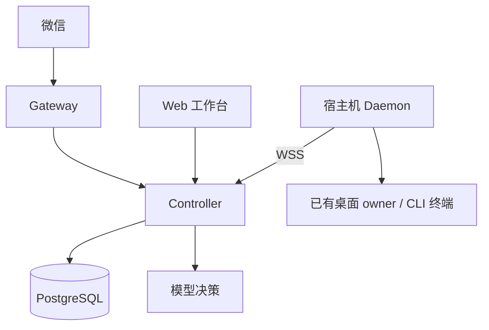

# wechat-super-leader-bot

微信 Super Leader 连接已有的 Codex 会话，提供查询、授权执行、计划、持续目标和结果回执。

## 架构



- **Controller**：唯一编排权威，负责鉴权、命令、计划、目标、通知和回执。
- **Gateway**：负责微信登录、轮询、入站排队、回复投递和防重。
- **Web**：通过认证 HTTP/SSE 访问 Controller。
- **Daemon**：主动连接 Controller，使用已存在的桌面 owner 或 CLI 终端。

业务记忆集中保存在 Controller 的 PostgreSQL `leader_states`，以 `chatId` 为键。
Gateway 不单独保存业务记忆，而是通过 Controller 使用同一份记录。
共享范围是同一聊天，不是所有聊天的全局共享；不同聊天隔离。
Daemon 只执行会话，不维护这份业务记忆。后台任务使用独立 thread 和工作目录。

## 能力

- 查询已有会话、历史和状态，并标明来源与时间。
- 校验聊天、目标、内容和技能后，向原会话发送任务。
- 持久化计划、持续目标、预算、依赖和完成回执。
- 会话忙或离线时排队，恢复后按序投递；未发送内容可取消。
- 保存成果和投递状态，避免重复发送。

工具调用必须绑定当前用户原文和准确的 `requestMessageId`。
状态不明确时保留原记录，禁止改 ID 盲目重发。

## 控制台登录

1. 在已授权微信聊天中请求控制台链接。
2. 打开一次性链接；页面会清除 fragment 并兑换 `HttpOnly` Cookie。
3. 登录态有效 1 小时，链接只能兑换一次。

Cookie 只允许读取工作台状态、历史、技能、事件和回执，或向准确会话发送、取消排队内容。
写请求还需同源 `Origin`、intent header 和会话资格。

## 本地开发

依赖：Node.js `>=24`、pnpm `11.8.0`、Go（以 `daemon/go.mod` 为准）和 Docker/Compose。

```sh
pnpm --dir controller install --frozen-lockfile
pnpm --dir gateway install --frozen-lockfile
pnpm --dir web install --frozen-lockfile
pnpm --dir gateway build
(cd daemon && go build -o bin/super-leader-daemon ./cmd/super-leader-daemon)
node scripts/local.mjs --init
node scripts/local.mjs --up
node scripts/local.mjs --daemon
node scripts/local.mjs --check
```

首次启动 Gateway，先建立基线，再开始轮询：

```sh
node gateway/dist/index.js --establish-baseline
node gateway/dist/index.js --run
```

`.runtime/local.json`、Daemon 状态、微信账号和 Gateway 状态都是私有运行数据，不提交仓库。
使用 Gateway 前必须配置并核对聊天允许名单。

Daemon 默认只读观察桌面状态和历史；发送必须显式配置 desktop socket 或准确的 CLI 终端。
owner 不符、失联或会话未加载时降级为只读，不创建替代会话，也不抢占已有 writer。

## 部署

基础编排是 `compose.yaml`；生产限制在 `deploy/compose.production.yaml`；Gateway 在
`deploy/compose.gateway.yaml`，只有选择 `wechat` profile 才启动。Web 构建在 Controller 镜像内。

创建权限为 `0600` 的 `.runtime/controller.env`，填入令牌、数据库密码、公开 HTTPS origin 和状态目录。
不要把密钥写入仓库、镜像或 shell 历史。

```sh
docker compose --env-file .runtime/controller.env \
  -f compose.yaml -f deploy/compose.production.yaml \
  -f deploy/compose.gateway.yaml --profile wechat config --quiet
```

跨架构构建时使用目标平台，并给镜像写入完整 revision：

```sh
docker buildx build --platform linux/amd64 --load \
  --build-arg VCS_REF=<commit> \
  -f deploy/Dockerfile.gateway -t super-leader-gateway:<tag> .
```

Controller 还需通过 `--label org.opencontainers.image.revision=<commit>` 注入 revision。
发布前检查平台、revision、镜像摘要和非 root smoke；生产只替换 Controller/Gateway 两个镜像字段。
合并到 `main` 后的生产 CD、VPS 前置条件、Environment Secrets/Variables 和回滚边界见
[`docs/production-deployment.md`](docs/production-deployment.md)。
生产 Gateway 只能运行一个实例，并保留数据库、微信账号和 Gateway 状态卷。

## 微信回复窗口与提醒

[按实际使用场景阅读白话说明](docs/wechat-message-journey.md)。

每条通过授权、去重和时间校验的真实新入站消息开启该收件人的 23 小时回复窗口；时间不早于账号最近一次入站时，将整个微信账号的共享额度刷新为 10 次。所有业务任务和会话共用这 10 次，文字分段、图片、文件和提醒均逐条扣减。续期提醒以账号额度窗口和实际收件人 token 窗口中较早到期者为准，仅在最后 1 小时（`22 小时 <= 已用时间 < 23 小时`）、聊天存在运行中任务、未来定时任务、待发成果或可恢复的待发回复，且有效剩余额度为 **1 或 2 次**时发送。同一账号窗口提醒一次，提示主动发消息刷新额度。

| 有效剩余额度 | 最后 1 小时内的续期提醒 |
| --- | --- |
| `>= 3` | 不提醒，普通回复和成果正常使用额度 |
| `1` 或 `2` | 优先提醒，提醒占用 1 次，可使用最后一次额度 |
| `0`，或窗口已过期 | 无法发送，等待真实新入站刷新 |

有效额度按持久账本与当前配置共同计算：`已消耗 = max(0, 账本获配额度 - 账本剩余额度)`，
`有效剩余 = min(账本剩余额度, max(0, 当前配置额度 - 已消耗))`。
旧账本缺少获配额度时，仅用当前配置上限约束原剩余额度，不补足额度。
例如获配 10 次、已用 8 次时剩余 2 次，提醒后剩余 1 次；已用 9 次时提醒后剩余 0 次，其余内容排队。

提醒优先于普通回复和成果；其他收件人的成果也要等待当前可发送的用户回复，过期收件人的待发回复不会挡住其他人。文字分段、图片和文件发送前都会重新检查；余量从 3 降到 2 时，后续分段让出额度给提醒。
额度用尽或窗口过期后，其余内容持久排队；下一条真实入站消息刷新后只续发未确认分段，不重跑任务。
已确认和发送结果未知的提醒记录跨重启保留，结果未知时不盲目重发。

`context_token` 和收件人窗口按微信账号及实际收件人保存，业务会话切换共用同一收件人的 token。B 的新消息可以刷新账号额度，并恢复其他仍在有效窗口内的收件人成果；不能延长 A 已过期的 token。跨收件人迟到的消息可更新自身窗口，但不重复补充账号额度。账号账本和窗口持久化为 `account_send_budget`、`context_windows`，重启不补额度。

升级时自动读取旧 `context_budgets`，保留 token 和窗口。旧版本没有逐次发送时间，多个旧账本会保守汇总重叠窗口的已知消耗，可能暂时少给额度；不会把各聊天余额相加。下一条时间有效的真实入站会恢复正常的共享 10 次。生产 Gateway 仅支持单实例、单状态文件；多个独立进程或状态文件不构成共享账本。

部署将 `GATEWAY_CONTEXT_WINDOW_MS` 固定为 `82800000`（23 小时），并在启动后核对实际容器值。

## 验证边界

自动化验证只使用本地 mock、合成数据和隔离容器，检查协议、状态机、幂等、持久化、恢复和发送前后逻辑。

微信登录、账号状态、收发消息和生产端到端链路只能由用户本人在生产环境手动验证。
我不能在生产上替你实测微信，也不会把 mock 结果写成微信实测结论。

```sh
node scripts/verify.mjs --list
node scripts/verify.mjs --suite unit
node scripts/verify.mjs --suite integration
node tests/integration/run.mjs
```

完整验证使用本地 Unix Docker socket、临时 PostgreSQL 和合成目标，不触达正式会话。
`accepted` 只表示接口受理，不表示微信手机已收到或已读。

## 回执

| 状态 | 含义 |
| --- | --- |
| `admitting` | 已保存，正在校验；尚未投递 |
| `queued` | 等待会话恢复；尚未投递 |
| `accepted` | 已受理，仍需核对准确 turn |
| `completed` | 对应 turn 已完成并有记录结果 |
| `input-written` | 输入已写入，执行尚未确认 |
| `uncertain` | 结果未知，先核查，不改 ID 重发 |
| 微信发送 `accepted` | 接口受理，不代表手机收到或已读 |

## 许可

项目使用 [PolyForm Noncommercial License 1.0.0](LICENSE) 发布。
商业用途和超出许可范围的使用需要 TaoSama 的书面授权。
