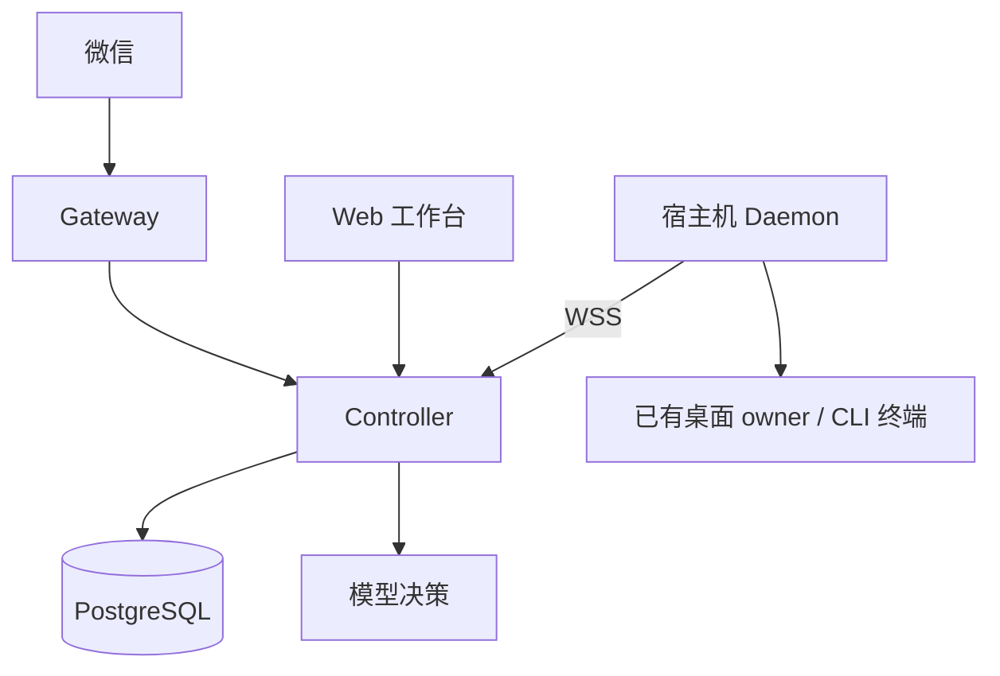

# wechat-super-leader-bot

通过微信连接已有的 Codex 会话：查询状态、授权执行、管理计划与持续目标，并回传结果回执。

## 架构



| 组件 | 职责 |
| --- | --- |
| Controller | 唯一编排权威：鉴权、命令、计划、目标、通知、回执 |
| Gateway | 微信登录、轮询、入站排队、回复投递与防重 |
| Web | 经认证的 HTTP/SSE 工作台 |
| Daemon | 主动连接 Controller，驱动已有桌面 owner 或 CLI 终端 |

业务记忆按 `chatId` 存于 PostgreSQL `leader_states`，同一聊天共享、不同聊天隔离；Gateway 与 Daemon 不保存业务记忆。

## 能力

- 查询会话、历史与状态，标注来源和时间。
- 校验聊天、目标、内容和技能后向原会话派发任务；工具调用绑定用户原文与 `requestMessageId`。
- 持久化计划、持续目标、预算、依赖与完成回执。
- 会话忙或离线时排队，恢复后按序投递，未发送内容可取消。
- 状态不明时保留原记录，不换 ID 重发。
- 后台定时任务的汇报格式可通过 `update_automation` 更新，仅影响后续轮次，详见 [docs/automation-prompt-updates.md](docs/automation-prompt-updates.md)。
- 后台任务默认由 Codex 执行；设置 `BACKGROUND_EXECUTOR=claude` 可改用 Claude Code（opt-in，生产启用前见 [docs/production-deployment.md](docs/production-deployment.md#claude-code-后台执行器opt-in)）。

## 控制台

- 在授权聊天中请求控制台链接；链接签发后 1 小时内有效，每次登录生成独立的 1 小时 `HttpOnly` Cookie。
- Cookie 仅可读取工作台数据，或向指定会话发送、取消排队内容；写请求还需同源 `Origin`、intent header 和会话资格。
- 回执和工具日志隐藏登录凭证；投递重试只复用原链接，不重新签发。
- 「主微信对话」展示当前 Codex Task 的原生历史，上下文由 Codex 原生 compact 管理，内容按规则脱敏并标记裁剪。

## 本地开发

依赖：Node.js `>=24`、pnpm `11.8.0`、Go（见 `daemon/go.mod`）、Docker Compose。

```sh
pnpm --dir controller install --frozen-lockfile
pnpm --dir gateway install --frozen-lockfile
pnpm --dir web install --frozen-lockfile
pnpm build

node scripts/local.mjs --init     # 生成私有配置 .runtime/local.json
node scripts/local.mjs --up       # 启动 Controller/Web/PostgreSQL
node scripts/local.mjs --daemon   # 前台运行 Daemon
node scripts/local.mjs --check    # 健康与鉴权检查
```

首次启动 Gateway 需先建立基线，再开始轮询（须先配置聊天允许名单）：

```sh
node gateway/dist/index.js --establish-baseline
node gateway/dist/index.js --run
```

- `.runtime/` 下的配置、Daemon 状态、微信账号和 Gateway 状态均为私有数据，不入库。
- Daemon 默认只读；发送需显式配置 desktop socket 或 CLI 终端。owner 不符或失联时降级为只读，不创建替代会话。
- 已有 Claude Code 会话默认关闭；Daemon 传 `--claude-projects-root <配置目录>/projects` 启用（可选 `--claude-path`、`--claude-permission-mode`，默认 `dontAsk`），仅续写近期无活动的会话。

## 部署

| 文件 | 用途 |
| --- | --- |
| `compose.yaml` | 基础编排 |
| `deploy/compose.production.yaml` | 生产限制 |
| `deploy/compose.gateway.yaml` | Gateway，仅 `wechat` profile 启动 |

密钥放在权限 `0600` 的 `.runtime/controller.env`，不写入仓库、镜像或 shell 历史。

```sh
docker compose --env-file .runtime/controller.env \
  -f compose.yaml -f deploy/compose.production.yaml \
  -f deploy/compose.gateway.yaml --profile wechat config --quiet
```

- 镜像按目标平台构建并写入 revision（Gateway 用 `--build-arg VCS_REF=<commit>`，Controller 用 `--label org.opencontainers.image.revision=<commit>`）。
- 生产 Gateway 仅单实例运行，保留数据库、微信账号和状态卷。
- CD 流程、Secrets 与回滚见 [docs/production-deployment.md](docs/production-deployment.md)。

## 微信回复窗口

场景说明见 [docs/wechat-message-journey.md](docs/wechat-message-journey.md)。

- 每条有效的真实入站消息为该收件人开启 23 小时回复窗口（`GATEWAY_CONTEXT_WINDOW_MS=82800000`），并将账号共享额度重置为 10 次（`GATEWAY_SEND_BUDGET`）。
- 文字分段、图片、文件和提醒逐条扣减额度，所有任务与会话共用。
- 窗口最后 1 小时内，若有运行中任务、定时任务或待发内容且额度 `>= 1`，发送一次续期提醒；提醒优先于普通回复。
- 额度耗尽或窗口过期后内容持久排队，下次入站后只续发未确认分段，不重跑任务。
- 普通回复被微信明确拒绝时，最多尝试 3 次后停止发送，不再消耗额度，也不阻塞该聊天后续消息。
- 结果未知或被拒绝的提醒不重发；账本持久化为 `account_send_budget`、`context_windows`，重启不补额度。

## 验证

```sh
node scripts/verify.mjs --list
node scripts/verify.mjs --suite unit
node scripts/verify.mjs --suite integration
```

自动化验证只使用 mock、合成数据和隔离容器，不触达真实会话或微信。微信收发与生产端到端链路需由用户在生产环境手动验证。

## 回执状态

| 状态 | 含义 |
| --- | --- |
| `admitting` | 已保存，校验中，未投递 |
| `queued` | 等待会话恢复，未投递 |
| `accepted` | 已受理，待核对 turn |
| `input-written` | 输入已写入，执行未确认 |
| `completed` | turn 已完成并记录结果 |
| `uncertain` | 结果未知，先核查，不换 ID 重发 |

微信发送的 `accepted` 仅表示接口受理，不代表手机已收到或已读。

## 许可

[PolyForm Noncommercial License 1.0.0](LICENSE)。商业使用需 TaoSama 书面授权。
